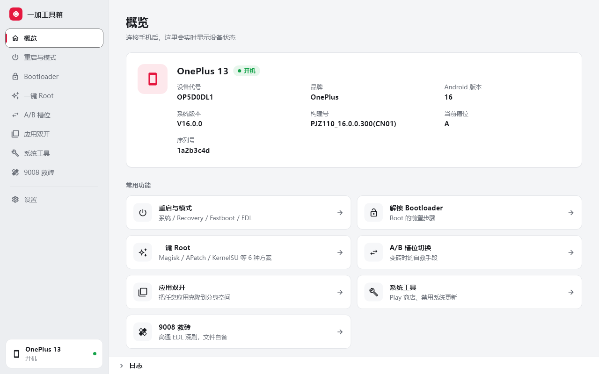
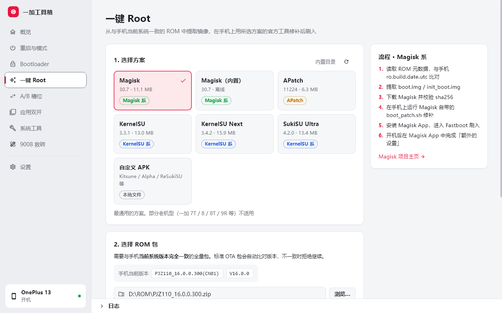
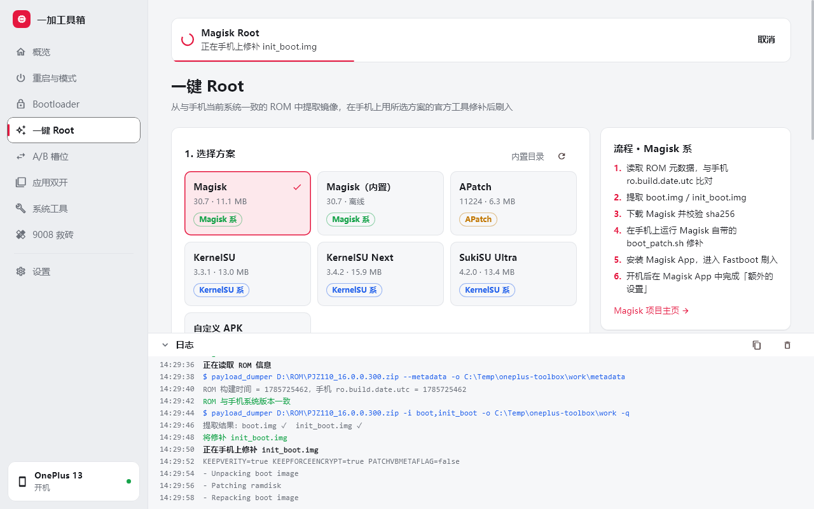
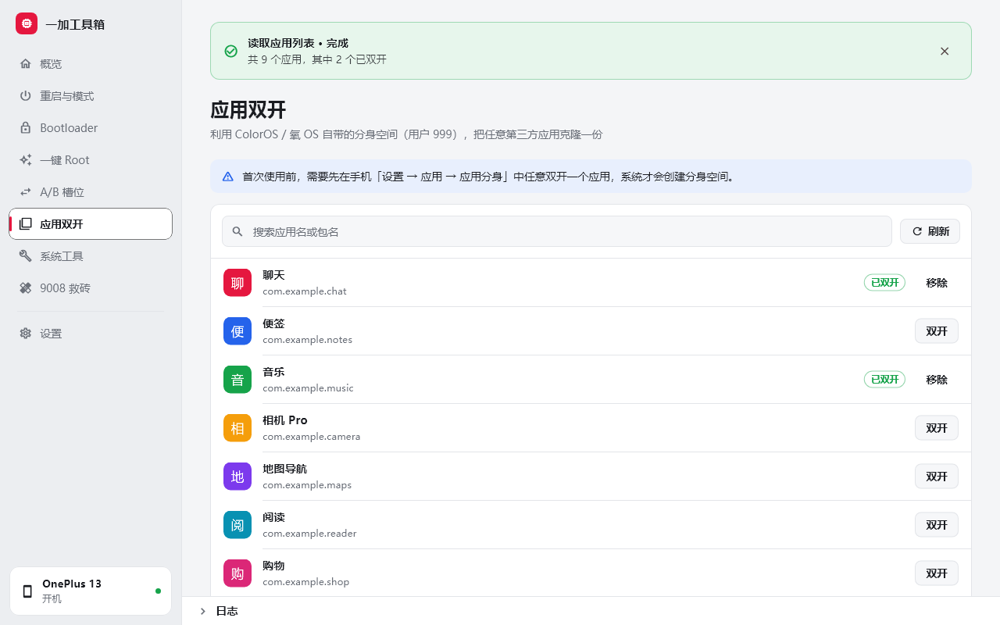
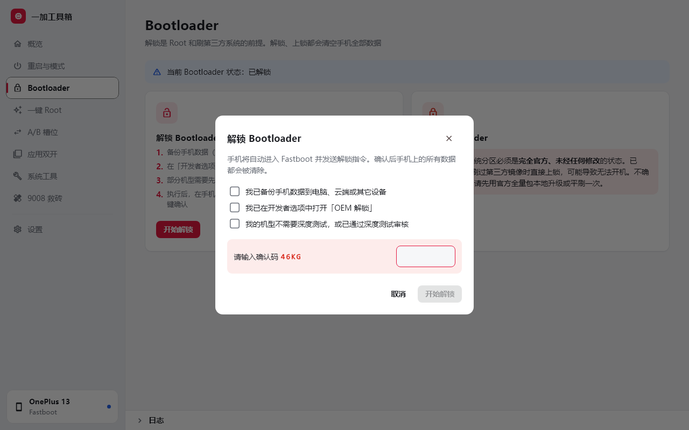
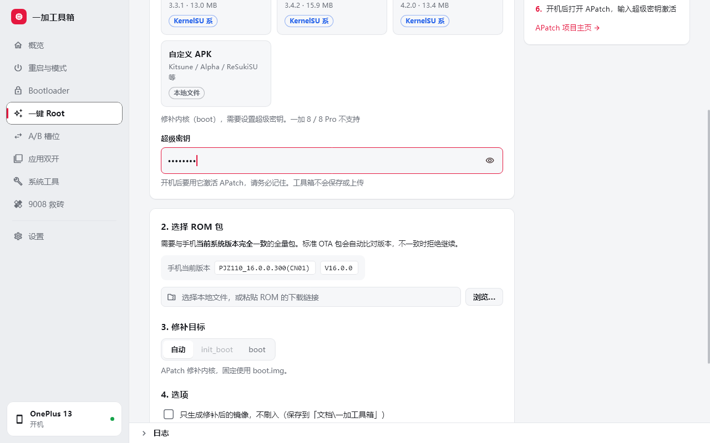
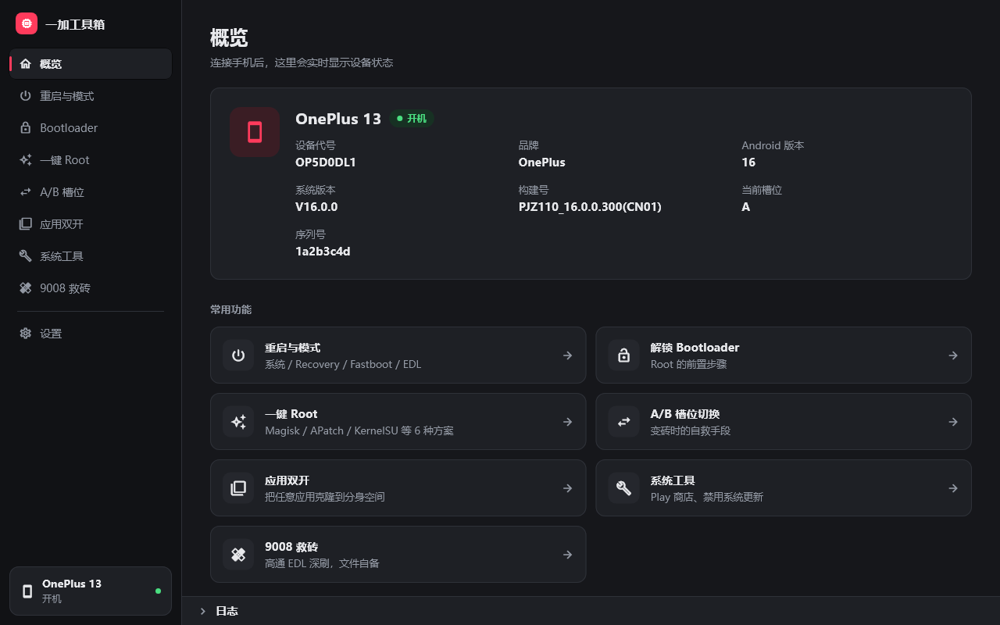
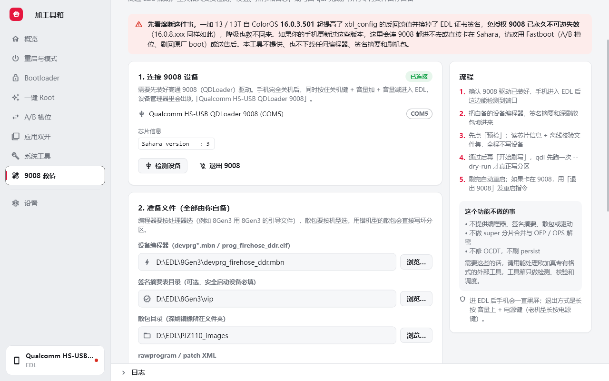

<div align="center">


# 一加工具箱 · Flutter 版

一加手机的桌面刷机助手：解锁 Bootloader、一键 Root、切换 A/B 槽位、9008 救砖、应用双开，全部在图形界面里完成。

[下载最新版本](../../releases/latest) · [常见问题](#常见问题) · [从源码构建](#从源码构建)



</div>

本仓库是 [oneplus-toolbox](../oneplus-toolbox)（Electron / TypeScript 版）的 Flutter 移植，功能与 TS 版一致，发到手机上的脚本逐字相同。

> [!WARNING]
> **刷机有风险。** 解锁或上锁 Bootloader 会清除手机上的全部数据；Root、刷写分区和 9008 深刷操作不当可能导致无法开机。本工具只在一加手机上开发和测试过（主要测试机型：一加 13），用于其它品牌时会弹出警告。请在完全理解每一步的后果后再操作，使用本工具造成的任何损失由使用者自行承担。

## 功能

| | 功能 | 说明 |
|---|---|---|
| 📱 | **设备概览** | 自动识别开机、Recovery、Fastboot、9008 四种状态，显示型号、系统版本、槽位、Bootloader 锁定状态 |
| 🔁 | **重启与模式** | 一键重启到系统、Recovery、Fastboot、EDL（9008），会根据当前模式自动选用 adb 或 fastboot |
| 🔓 | **Bootloader 解锁 / 上锁** | 先检查当前状态，避免重复操作；勾选确认清单并输入确认码后才会执行 |
| ✨ | **一键 Root** | 支持 Magisk、APatch、KernelSU、KernelSU Next、SukiSU Ultra，以及自定义 APK |
| 🔀 | **A/B 槽位切换** | 刷坏一个槽位时，切到另一个槽位往往能重新开机 |
| 🛟 | **9008 救砖** | 高通 EDL 深刷的向导：检测 9008 端口、读芯片信息、校验并调度 qdl 刷写（编程器、签名摘要、散包需自备） |
| 👥 | **应用双开** | 列出所有第三方应用（带图标、可搜索），一键克隆到系统的分身空间 |
| 🛠️ | **系统工具** | 安装 Play 商店；禁用 / 恢复系统更新 |

<table>
  <tr>
    <td></td>
    <td></td>
  </tr>
  <tr>
    <td></td>
    <td></td>
  </tr>
  <tr>
    <td></td>
    <td></td>
  </tr>
</table>

<sub>截图使用的是模拟数据，由 `melos run screenshots` 生成。界面会跟随系统自动切换浅色 / 深色模式。</sub>

### 一键 Root 的流程

1. 选择与手机**当前系统版本完全一致**的完整 OTA 包，可以是本地文件，也可以直接粘贴下载链接（只会读取需要的部分，不会下载整个包）
2. 读取 ROM 的构建时间，与手机的 `ro.build.date.utc` 比对，**不一致就直接停止**
3. 提取 `init_boot.img`（Android 13 及以后出厂的机型）或 `boot.img`
4. 从项目官方的 GitHub Releases 下载所选方案的 APK，**强制校验 sha256**
5. 推送到手机，用该方案自带的官方工具修补，修补后的镜像另存一份到「文档\一加工具箱」
6. 安装管理器 App，重启到 Fastboot，确认已解锁后刷入

如果只想要修补好的镜像、自己手动刷，可以勾选「只生成修补后的镜像，不刷入」。

| 方案 | 修补方式 |
|---|---|
| Magisk（在线 / 离线内置） | Magisk 自带的 `boot_patch.sh` |
| APatch | APatch 自带的 `boot_patch.sh`，需要设置超级密钥，只修补 boot |
| KernelSU / KernelSU Next / SukiSU Ultra | `ksud boot-patch`（LKM 模式），失败时自动按设备推算 KMI 重试 |
| 自定义 APK | Kitsune、Magisk Alpha、ReSukiSU 等分支，手动选择上面三种修补方式之一 |

各方案的版本和下载地址可以通过远程目录更新，不需要发布新版本。目录格式与 TS 版通用，见 TS 版的 `catalog/README.md`。

### 9008 救砖

手机彻底不开机、连 Fastboot 都进不去时，最后的手段是靠高通 9008（EDL）深刷。工具箱在这里只做四件事：

1. **检测设备**：识别设备管理器里的 `Qualcomm HS-USB QDLoader 9008` 端口
2. **预检**：用 `qdl chipinfo` 通过 Sahara 读出芯片信息，再离线跑一遍 `qdl --dry-run` 校验文件集与签名摘要是否一致
3. **调度刷写**：按 `rawprogram*` → `patch*` 的顺序交给 [qdl](https://github.com/linux-msm/qdl) 刷写，默认跳过 `rawprogram5` / `patch5`；真正刷写前一定会先自动预检一次，不通过就不碰设备
4. **风险提示**：每一步都要勾选确认清单，真正刷写前还要输入确认码



> [!IMPORTANT]
> **熔断警告：一加 13 / 13T 从 ColorOS 16.0.3.501 起（16.0.8.xxx 同样），OPPO 提高了 `xbl_config` 的反回滚值并更换了 EDL 证书签名，9008 免授权被永久不可逆熔断，降级也无法恢复。**
> 如果你的手机是最近才更新的系统，本功能大概率用不了，请改用 A/B 槽位切换、刷回原厂 boot，或者联系售后。给手机**关掉系统更新**是保住 9008 的唯一办法。

工具箱**不提供、也不下载**下面这些文件，需要你自己准备（用错机型的散包会直接写坏分区）：

| 文件 | 说明 |
|---|---|
| 设备编程器 | `devprg*.mbn`，按处理器型号选（例如 8Gen3 用 8Gen3 的） |
| 签名摘要表 | 安全启动设备需要，对应 qdl 的 `--vip-table-path` |
| 深刷散包 | 解压后的 `rawprogram*.xml` / `patch*.xml` 和一堆镜像 |
| 9008 驱动 | 高通 QDLoader 驱动，需自行安装 |

**这个功能不做的事**：不合并 super 分片，不解密 OFP / OPS，不修 OCDT，不刷 persist。需要这些请用能处理欧加真专有格式的外部工具。

## 安全设计

- **不执行任何远程脚本**：所有修补逻辑都写在程序里；远程方案目录只能指定 APK 的下载地址和 sha256
- **所有下载都校验 sha256**：校验不通过的文件会被直接丢弃
- **不打包任何专有刷机文件**：9008 需要的设备编程器、签名摘要和散包一律由用户自备，工具箱只做校验和调度
- **ROM 版本校验**：ROM 与手机系统版本不一致时拒绝继续
- **危险操作需要确认**：解锁、上锁、Root、进入 EDL、9008 刷写前，都要勾选确认清单，部分操作还要输入随机确认码
- **非一加设备警告**：检测到其它品牌时弹出警告，15 秒后才能关闭
- **只动自己的文件**：手机上只读写 `/data/local/tmp/oneplus-toolbox`；电脑上不会结束其它程序启动的 adb

## 使用前准备

1. 在手机「设置 → 关于手机」中连续点击版本号，打开开发者选项
2. 在「开发者选项」中打开 **USB 调试**；如果要解锁，还需要打开 **OEM 解锁**
3. 用支持数据传输的线连接电脑，在手机弹窗中勾选「始终允许」并点击允许
4. 如果一直检测不到设备，请安装 [Google USB 驱动](https://developer.android.com/studio/run/win-usb)

## 下载与安装

在 [Releases](../../releases/latest) 页面下载 `OnePlusToolbox-Flutter-x.y.z-win-x64.zip`，解压到任意目录后运行 `oneplus_toolbox.exe`，免安装。

每个版本都附带 `SHA256SUMS.txt`，可以用来核对下载的文件是否完整。

> [!NOTE]
> 程序没有代码签名，首次运行时 Windows SmartScreen 可能提示「Windows 已保护你的电脑」，点击「更多信息 → 仍要运行」即可。如果不放心，可以从源码自行构建。

系统要求：Windows 10 / 11（64 位）。设置、方案目录缓存和 APK 缓存与 Electron 版共用 `%APPDATA%\一加工具箱`，两个版本可以互相切换。

## 常见问题

**检测不到手机？**
换一根支持数据传输的线、换一个 USB 口，并确认已安装 USB 驱动。手机上如果出现 USB 调试授权弹窗，要点「允许」。

**解锁时提示失败？**
确认已在开发者选项中打开「OEM 解锁」。部分机型需要先申请并通过「深度测试」才能解锁。

**Root 时提示 ROM 与手机版本不一致？**
ROM 必须和手机当前的系统版本完全相同，换一个对应版本的完整 OTA 包即可。这一步是为了防止刷入不匹配的镜像导致无法开机，不能跳过。

**KernelSU 修补失败？**
KernelSU 系方案只支持 GKI 2.0 设备（Android 12 及以后出厂、内核 5.10 以上）。修补失败时不会刷入任何东西，可以改用 Magisk 或 APatch。

**双开的应用在重启后不见了？**
这是 ColorOS 桌面的限制，分身应用其实还在，可以改用第三方桌面，或者回到工具箱重新双开。

**刷完无法开机？**
先别慌。进入 Fastboot 后，可以在「A/B 槽位」中切换到另一个槽位；或者把 ROM 中原厂的 boot / init_boot 刷回去。连 Fastboot 都进不去时，才需要用到「9008 救砖」。

**9008 里读不到芯片信息？**
说明 Sahara 还没通。按顺序检查：9008 驱动是否装好、设备管理器里是否出现 `Qualcomm HS-USB QDLoader 9008`、数据线是否支持数据传输、手机是否真的进了 EDL。如果都正常还是读不到，这台机器很可能已经被系统更新熔断了免授权 EDL，只能送售后。

**我应该更新系统吗？**
如果在意 9008 救砖，**不要更新**。一加 13 / 13T 的 16.0.3.501 和 16.0.8.xxx 会永久熔断免授权 EDL，且降级无效。可以先用「系统工具 → 禁用系统更新」把更新关掉。

## 从源码构建

前置条件：

- Flutter 3.22+（Dart 3.4+），`dart pub global activate melos`
- 构建 Windows 版需要 Visual Studio（「使用 C++ 的桌面开发」工作负载），并在系统设置中开启**开发者模式**（插件需要符号链接）

```bash
melos bootstrap
melos run fetch-tools    # 首次运行，或升级工具版本后
melos exec --scope=oneplus_toolbox -- flutter run -d windows
```

第三方工具（adb、fastboot、payload_dumper、7za、aapt2、qdl、Magisk）不提交到仓库：`melos run fetch-tools` 从官方地址下载并校验 sha256，放到 `resources/bin`；构建时 CMake 会把它复制到 exe 旁边的 `bin/`。版本与 TS 版的 `scripts/fetch-tools.mjs` 一致。

其它命令：

| 命令 | 作用 |
|---|---|
| `melos run analyze` | 静态检查 |
| `melos run test` | 全部测试 |
| `melos run check:layers` | 分层检查 |
| `melos run format` | 格式化（120 列） |
| `melos run build:windows` | 发布版，输出在 `apps/oneplus_toolbox/build/windows/x64/runner/Release` |
| `melos run screenshots` | 用模拟数据重新生成 `docs/screenshots` 下的截图（需在 Windows 上运行，用系统自带的微软雅黑渲染） |

构建时可用 `--dart-define=TOOLBOX_VERSION=x.y.z` 和 `--dart-define=TOOLBOX_UPDATE_REPO=owner/repo` 指定版本号和默认更新仓库（对应 TS 版的 `TOOLBOX_UPDATE_REPO` 环境变量）。

### 发布新版本

`.github/workflows/build.yml`：

- 推送到 main、提交 PR：运行静态检查、格式检查、分层检查和全部测试，然后构建 Windows 版，zip 包可在 Actions 页面下载（保留 14 天）
- 推送 `v` 开头的标签：用标签作为版本号构建，并创建 Release 草稿（附 zip 和 `SHA256SUMS.txt`），检查后在 GitHub 上手动发布
- 构建时把当前仓库写入「检查更新」的默认仓库

```bash
git tag v0.2.0
git push origin v0.2.0
```

### 项目结构

用 [melos](https://melos.invertase.dev) 管理的多包工作区，按职责分成四层，依赖只能向下：

```
apps/oneplus_toolbox        UI：页面、组件、交互状态（Flutter）
     │  只依赖 toolbox_service
     ▼
packages/toolbox_service    业务：设备轮询、各项操作的流程编排与安全检查、方案目录、设置、更新检查
     │                      对外只暴露 ToolboxService 一个入口
     ▼
packages/toolbox_commands   命令：adb / fastboot / payload_dumper / 7-Zip / qdl、校验下载、手机端脚本
     │                      只负责「怎么执行、怎么解析输出」，不做业务判断
     ▼
packages/toolbox_core       共享模型、内置方案目录、校验规则、取消令牌（纯 Dart，无 IO）
```

`melos run check:layers` 会检查每个包的 pubspec 依赖和 `package:` 导入（例如界面直接 import `toolbox_commands` 会报错）。除界面外的三层都是纯 Dart 包，可以单独用 `dart test` 测试。

```
apps/oneplus_toolbox/lib/src/pages/       各功能页面（edl_page.dart 为 9008 救砖）
apps/oneplus_toolbox/tool/screenshots/    截图脚本与模拟数据
packages/toolbox_service/lib/src/
  device_probe.dart                       设备识别（adb / fastboot / 9008 三路）、getprop / getvar
  ops/basic.dart                          重启、解锁 / 上锁、切换槽位
  ops/root.dart                           一键 Root 主流程（提取镜像、修补、刷入）
  ops/edl.dart                            9008 救砖（检测、预检、校验文件集、调度 qdl）
  ops/apps.dart                           应用双开、Play 商店、系统更新开关
packages/toolbox_commands/lib/src/        adb、fastboot、qdl 等命令封装，手机端修补脚本
tool/fetch_tools.dart                     下载并校验第三方工具（含 qdl）
```

### 与 TS 版的对应关系

| TS 版 | Flutter 版 |
| --- | --- |
| `src/shared/types.ts`、`catalog.ts` | `toolbox_core` |
| `src/main/exec.ts`、`download.ts`、`ops/patch-script.ts` 及各命令调用 | `toolbox_commands` |
| `src/main/index.ts`（IPC）、`device.ts`、`ops/*`、`catalog.ts`、`settings.ts`、`update.ts` | `toolbox_service`（`ToolboxService` 取代 IPC） |
| `src/renderer` | `apps/oneplus_toolbox` |
| `scripts/fetch-tools.mjs` | `tool/fetch_tools.dart` |
| `scripts/screenshots/` | `apps/oneplus_toolbox/tool/screenshots/` |

- 发到手机上的脚本与 TS 版逐字一致，由 `toolbox_commands/test/golden/` 中的快照测试保证（快照由 TS 版生成，TS 版修改脚本后需同步更新）
- 截图场景和模拟数据与 TS 版一一对应，两边界面改动后各自重新生成即可
- 修补后的镜像同样保存到「文档\一加工具箱」

## 许可证

本项目以 [Apache License 2.0](LICENSE) 发布。随附和运行时下载的第三方组件（adb、qdl、Magisk、KernelSU 等）遵循各自的许可证，详见 [THIRD_PARTY_NOTICES.md](THIRD_PARTY_NOTICES.md)。

本项目与 OnePlus、Google 以及各 Root 方案的作者均无关联。
