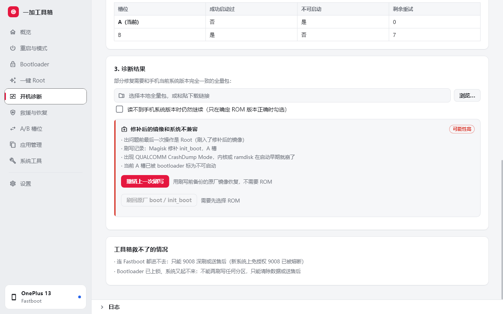
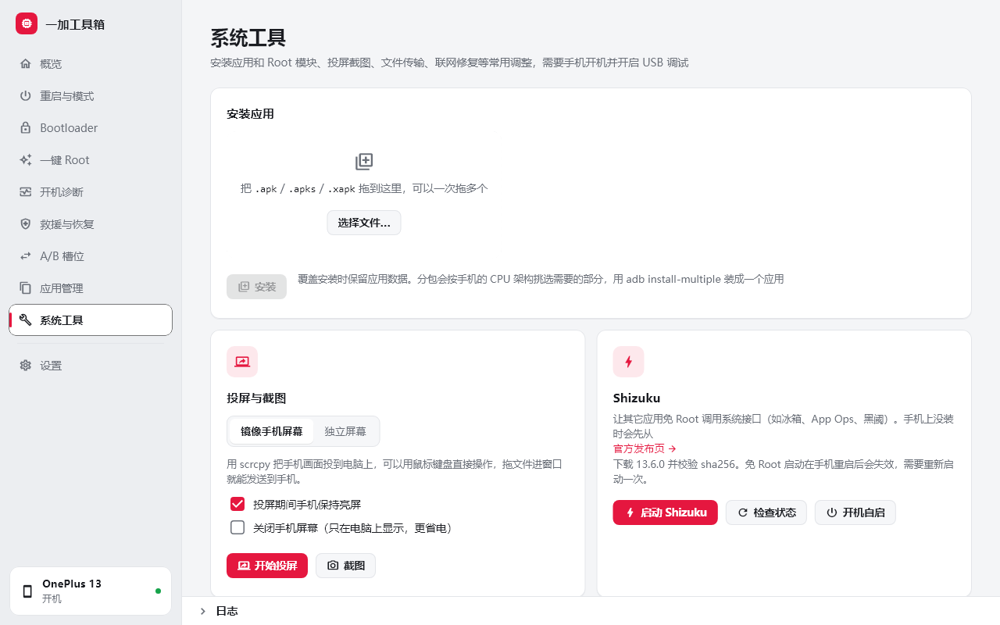
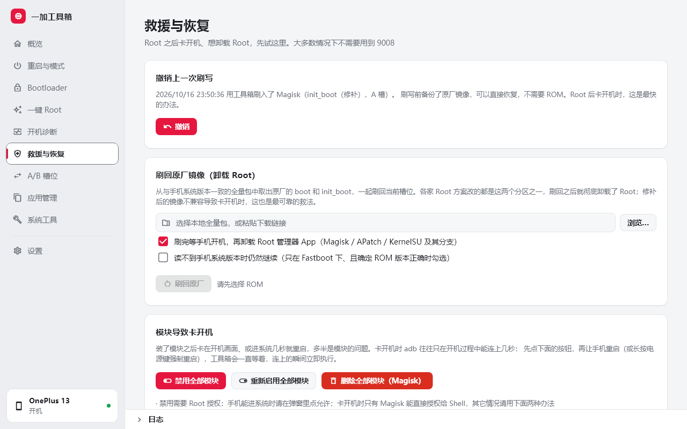

<div align="center">


# 一加工具箱 · Flutter 版

一加手机的桌面刷机助手：解锁 Bootloader、一键 Root、开机诊断与卡开机救援、切换 A/B 槽位、安装应用、应用双开、投屏和文件传输，全部在图形界面里完成。

[下载最新版本](../../releases/latest) · [常见问题](#常见问题) · [从源码构建](#从源码构建)


</div>

本仓库是 [oneplus-toolbox](../oneplus-toolbox)（Electron / TypeScript 版）的 Flutter 移植，功能与 TS 版一致，发到手机上的脚本逐字相同。

> [!WARNING]
> **刷机有风险。** 解锁或上锁 Bootloader 会清除手机上的全部数据；Root 和刷写分区操作不当可能导致无法开机。本工具只在一加手机上开发和测试过（主要测试机型：一加 13），用于其它品牌时会弹出警告。请在完全理解每一步的后果后再操作，使用本工具造成的任何损失由使用者自行承担。

## 功能

| | 功能 | 说明 |
|---|---|---|
| 📱 | **设备概览** | 自动识别开机、Recovery、Fastboot、fastbootd 四种状态，显示型号、系统版本、槽位、Bootloader 锁定状态和 Root 状态；检测不到手机时可以一键检查驱动 |
| 🔁 | **重启与模式** | 一键重启到系统、Recovery、Fastboot、fastbootd，会根据当前模式自动选用 adb 或 fastboot |
| 🔓 | **Bootloader 解锁 / 上锁** | 先检查当前状态，避免重复操作；上锁前确认没有 Root、没有未撤销的刷写；勾选确认清单并输入确认码后才会执行 |
| ✨ | **一键 Root** | 支持 Magisk、APatch、KernelSU、KernelSU Next、SukiSU Ultra，以及自定义 APK；刷写前自动备份原厂镜像 |
| 🩺 | **开机诊断** | 卡开机时选择看到的现象，读取槽位、解锁、系统更新合并等状态，推断可能的原因并直接给出修复按钮 |
| 🛟 | **救援与恢复** | 一键撤销上一次刷写；刷回原厂 boot / init_boot（卸载 Root）；模块导致卡开机时禁用 / 启用 / 删除全部模块；备份 persist、基带等关键分区 |
| 🔀 | **A/B 槽位切换** | 刷坏一个槽位时，切到另一个槽位往往能重新开机 |
| 📦 | **安装应用** | 拖拽批量安装 `.apk`，支持 `.apks` / `.xapk` 分包（按 CPU 架构挑选分包，自动推送 OBB） |
| 👥 | **应用管理** | 应用双开：一键把第三方应用克隆到分身空间；冻结 / 解冻应用；一键授予应用需要的 adb 权限（WRITE_SECURE_SETTINGS 等，免去手敲命令）；备份应用安装包（分包打成 `.apks`），已 Root 时可连同应用数据一起备份和恢复；预装应用：免 Root 卸载、冻结或恢复，系统必需组件不允许操作 |
| 🖥️ | **投屏、截图、文件传输** | 内置 scrcpy 投屏，可用鼠标键盘操作手机；「独立屏幕」模式在手机上新建一块虚拟屏幕，电脑上用一个应用、手机上照常用别的，互不影响；一键截图；浏览手机存储，拖拽发送、点击接收文件 |
| 📶 | **无线调试** | `adb pair` / `adb connect`，或者插着线一键切到无线 |
| 🔌 | **多设备** | 同时连了多台手机时，在左下角选择要操作的那一台；没选之前所有操作都会被拒绝 |
| 🛠️ | **系统工具** | 一键安装、启动 Shizuku，并设置免 Root 开机自启（Android 13+）；拖入 zip 安装 Root 模块（Magisk / KernelSU / APatch）；修复 Wi-Fi 感叹号（联网检测改成国内地址）、设置私人 DNS；安装 Play 商店；禁用 / 恢复系统更新 |
| 📝 | **日志与诊断** | 操作日志自动保存 30 天；一键导出诊断信息（序列号自动打码），提交问题反馈时附上 |
| ⬆️ | **检查更新** | 发现新版本后在设置页提示，并可跳转到发布页下载 |

<table>
  <tr>
    <td></td>
    <td></td>
  </tr>
  <tr>
    <td></td>
    <td></td>
  </tr>
  <tr>
    <td></td>
    <td></td>
  </tr>
  <tr>
    <td></td>
    <td></td>
  </tr>
</table>

<sub>截图使用的是模拟数据，由 `melos run screenshots` 生成。界面会跟随系统自动切换浅色 / 深色模式。</sub>

### 一键 Root 的流程

1. 选择与手机**当前系统版本完全一致**的完整 OTA 包，可以是本地文件，也可以直接粘贴下载链接（只会读取需要的部分，不会下载整个包）
2. 读取 ROM 的构建时间，与手机的 `ro.build.date.utc` 比对，**不一致就直接停止**
3. 提取 `init_boot.img`（Android 13 及以后出厂的机型）或 `boot.img`
4. 从项目官方的 GitHub Releases 下载所选方案的 APK，**强制校验 sha256**
5. 推送到手机，用该方案自带的官方工具修补，修补后的镜像另存一份到「文档\一加工具箱」
6. 安装管理器 App，重启到 Fastboot，确认已解锁后刷入

如果只想要修补好的镜像、自己手动刷，可以勾选「只生成修补后的镜像，不刷入」。

| 方案 | 修补方式 |
|---|---|
| Magisk（在线 / 离线内置） | Magisk 自带的 `boot_patch.sh` |
| APatch | APatch 自带的 `boot_patch.sh`，需要设置超级密钥，只修补 boot |
| KernelSU / KernelSU Next / SukiSU Ultra | `ksud boot-patch`（LKM 模式），失败时自动按设备推算 KMI 重试 |
| 自定义 APK | Kitsune、Magisk Alpha、ReSukiSU 等分支，手动选择上面三种修补方式之一 |

各方案的版本和下载地址可以通过远程目录更新，不需要发布新版本。目录格式与 TS 版通用，见 TS 版的 `catalog/README.md`。

### 开机诊断

卡开机、开不了机但还能进 Fastboot 时，不确定该用哪种救法就先来这里：

1. 选择看到的现象（停在 logo、反复重启、CrashDump、image destroyed、自动进 Recovery）和出问题前最后做的操作；工具箱刷过 Root 的话会自动预选
2. 读取设备状态（只读）：Fastboot 下读两个槽位的「成功启动过 / 不可启动 / 剩余重试次数」、解锁状态、系统更新合并状态；卡在开机画面时抓开机过程中 adb 能连上的那几秒，读系统属性和崩溃日志
3. 按规则推断可能的原因（修补镜像不兼容、模块、vbmeta 校验、更新没合并完、只刷了一半、数据不兼容等），按可能性排序，每条都附上判断依据和修复按钮

判断规则是带单元测试的纯函数（`packages/toolbox_core/lib/src/bootdiag.dart`），槽位字段的格式和行为都在一加 13 上实测过：正常 OTA 之后另一个槽位会被标为不可启动，这不算故障；fastbootd 报告的「成功启动过」和 bootloader 不一致，诊断时只采信 bootloader 的。

### 救援与恢复

Root 之后卡开机、或者想卸载 Root 时用。前提是还能进 Fastboot（刷回原厂）或 adb 能连上（处理模块），大多数情况下不需要用到 9008。

- **撤销上一次刷写**：工具箱每次刷入修补镜像前，都会记下槽位、分区、系统版本和 sha256，并把原厂镜像备份到「文档\一加工具箱\backups」。卡开机时一键刷回原来的槽位，不需要再找 ROM；之后升级过系统的话会拒绝执行
- **刷回原厂镜像**：从与手机系统版本一致的全量包里取出原厂的 `boot` 和 `init_boot`，一起刷回当前槽位，可选在开机后卸载 Root 管理器 App。开机状态下会比对 ROM 与手机版本；只能进 Fastboot 时，使用这台手机上次开机连接时记下的版本来校验，从来没连过的话需要你明确勾选才会继续
- **模块导致卡开机**：先点按钮再让手机重启，工具箱会一直等到开机过程中 adb 连上的那几秒，立即执行
  - 禁用全部模块：给每个模块写入 `disable` 标记，可以在这里或 Root 管理器里重新启用（需要 Root 授权）
  - 删除全部模块：Magisk 官方的救砖命令 `magisk --remove-modules`，不需要授权，但模块会被删掉
  - KernelSU / APatch 也可以进安全模式：开机出现第一屏后连续按几次音量下键
- **备份关键分区**：已 Root 时读出 `persist`、`modemst1/2`、`fsg`、`ocdt` 等存着基带和校准数据的分区（坏了刷什么 ROM 都恢复不了），连同当前槽位的启动镜像，附带 sha256 校验文件；没 Root 时可以从 ROM 里提取原厂启动镜像存到本地



### 9008 救砖（暂时停用）

9008（高通 EDL）深刷的入口已经隐藏，业务层也会拒绝执行相关操作（代码保留在 `packages/toolbox_service/lib/src/ops/edl.dart`，开关在 `packages/toolbox_core/lib/src/features.dart` 的 `Features.edl`）。原因是：

- 新系统上免授权 9008 已经熔断，大多数用户用不了
- 编程器、签名摘要和散包都要用户自备，用错机型的文件会直接写坏分区，风险远大于收益

> [!IMPORTANT]
> **熔断警告：一加 13 / 13T 从 ColorOS 16.0.3.501 起（16.0.8.xxx 同样），OPPO 提高了 `xbl_config` 的反回滚值并更换了 EDL 证书签名，9008 免授权被永久不可逆熔断，降级也无法恢复。**
> 如果在意 9008，给手机**关掉系统更新**是保住它的唯一办法（「系统工具 → 禁用系统更新」）。

## 安全设计

- **不执行任何远程脚本**：所有修补逻辑都写在程序里；远程方案目录只能指定 APK 的下载地址和 sha256
- **所有下载都校验 sha256**：校验不通过的文件会被直接丢弃
- **ROM 版本校验**：Root 和刷回原厂时，ROM 与手机系统版本不一致就拒绝继续
- **危险操作需要确认**：解锁、上锁、Root、刷回原厂、删除模块前，都要勾选确认清单，部分操作还要输入随机确认码
- **刷写可追溯、可撤销**：每次刷写都记下槽位、分区和镜像的 sha256，并先备份原厂镜像；撤销时校验备份没被改动过
- **上锁前检查**：手机还有 Root、或者工具箱记录到没撤销的 Root 刷写时，拒绝上锁（镜像被改过的手机上锁后会起不来，而且不能再刷写）
- **多台设备不会刷错**：连了多台设备时必须先选中一台，重启后等待的也只认这一台
- **预装应用只对当前用户卸载**：随时可以恢复；开机、解锁、权限管理等必需组件锁定不能卸载
- **非一加设备警告**：检测到其它品牌时弹出警告，15 秒后才能关闭
- **只动自己的文件**：手机上只读写 `/data/local/tmp/oneplus-toolbox`（禁用模块时会在 `/data/adb/modules/*` 下写 `disable` 标记）；电脑上不会结束其它程序启动的 adb
- **诊断信息不含隐私**：只导出与刷机相关的系统属性，序列号打码，Windows 用户名替换成占位符

## 使用前准备

1. 在手机「设置 → 关于手机」中连续点击版本号，打开开发者选项
2. 在「开发者选项」中打开 **USB 调试**；如果要解锁，还需要打开 **OEM 解锁**
3. 用支持数据传输的线连接电脑，在手机弹窗中勾选「始终允许」并点击允许
4. 如果一直检测不到设备，请安装 [Google USB 驱动](https://developer.android.com/studio/run/win-usb)

## 下载与安装

在 [Releases](../../releases/latest) 页面下载 `OnePlusToolbox-Flutter-x.y.z-win-x64.zip`，解压到任意目录后运行 `oneplus_toolbox.exe`，免安装。

每个版本都附带 `SHA256SUMS.txt`，可以用来核对下载的文件是否完整。

> [!NOTE]
> 程序没有代码签名，首次运行时 Windows SmartScreen 可能提示「Windows 已保护你的电脑」，点击「更多信息 → 仍要运行」即可。如果不放心，可以从源码自行构建。

系统要求：Windows 10 / 11（64 位）。设置、方案目录缓存和 APK 缓存与 Electron 版共用 `%APPDATA%\一加工具箱`，两个版本可以互相切换；修补后的镜像、原厂镜像备份、日志、截图和应用备份则都放在「文档\一加工具箱」下。

## 常见问题

**检测不到手机？**
换一根支持数据传输的线、换一个 USB 口，并确认已安装 USB 驱动。手机上如果出现 USB 调试授权弹窗，要点「允许」。概览页的「检查驱动」会列出设备管理器里和手机有关的设备，告诉你缺的是哪个驱动。

**解锁时提示失败？**
确认已在开发者选项中打开「OEM 解锁」。部分机型需要先申请并通过「深度测试」才能解锁。

**Root 时提示 ROM 与手机版本不一致？**
ROM 必须和手机当前的系统版本完全相同，换一个对应版本的完整 OTA 包即可。这一步是为了防止刷入不匹配的镜像导致无法开机，不能跳过。

**KernelSU 修补失败？**
KernelSU 系方案只支持 GKI 2.0 设备（Android 12 及以后出厂、内核 5.10 以上）。修补失败时不会刷入任何东西，可以改用 Magisk 或 APatch。

**双开的应用在重启后不见了？**
这是 ColorOS 桌面的限制，分身应用其实还在，可以改用第三方桌面，或者回到工具箱重新双开。

**刷完无法开机？**
先别慌，也不要反复尝试。让手机进 Fastboot（关机后同时按住 音量下 + 电源键），打开「开机诊断」，选择看到的现象后读取状态，按推荐的办法处理。最常见的两种：刚用工具箱 Root 完卡开机，用「救援与恢复 → 撤销上一次刷写」；刚装了模块卡开机，用「禁用全部模块」。连 Fastboot 都进不去时，请联系售后。

**提交问题时需要附什么？**
在「设置 → 日志与诊断」中点「导出诊断信息」，把生成的文件附在问题反馈里。日志平时保存在「文档\一加工具箱\logs」。

**我应该更新系统吗？**
如果在意 9008 救砖，**不要更新**。一加 13 / 13T 的 16.0.3.501 和 16.0.8.xxx 会永久熔断免授权 EDL，且降级无效。可以先用「系统工具 → 禁用系统更新」把更新关掉。

## 从源码构建

前置条件：

- Flutter 3.22+（Dart 3.4+），`dart pub global activate melos`
- 构建 Windows 版需要 Visual Studio（「使用 C++ 的桌面开发」工作负载），并在系统设置中开启**开发者模式**（插件需要符号链接）

```bash
melos bootstrap
melos run fetch-tools    # 首次运行，或升级工具版本后
melos exec --scope=oneplus_toolbox -- flutter run -d windows
```

第三方工具（adb、fastboot、payload_dumper、7za、aapt2、scrcpy、qdl、Magisk）不提交到仓库：`melos run fetch-tools` 从官方地址下载并校验 sha256，放到 `resources/bin`；构建时 CMake 会把它复制到 exe 旁边的 `bin/`。版本与 TS 版的 `scripts/fetch-tools.mjs` 一致。

其它命令：

| 命令 | 作用 |
|---|---|
| `melos run analyze` | 静态检查 |
| `melos run test` | 全部测试 |
| `melos run check:layers` | 分层检查 |
| `melos run format` | 格式化（120 列） |
| `melos run build:windows` | 发布版，输出在 `apps/oneplus_toolbox/build/windows/x64/runner/Release` |
| `melos run screenshots` | 用模拟数据重新生成 `docs/screenshots` 下的截图（需在 Windows 上运行，用系统自带的微软雅黑渲染） |

构建时可用 `--dart-define=TOOLBOX_VERSION=x.y.z` 和 `--dart-define=TOOLBOX_UPDATE_REPO=owner/repo` 指定版本号和默认更新仓库（对应 TS 版的 `TOOLBOX_UPDATE_REPO` 环境变量）。

### 发布新版本

`.github/workflows/build.yml`：

- 推送到 main、提交 PR：运行静态检查、格式检查、分层检查和全部测试，然后构建 Windows 版，zip 包可在 Actions 页面下载（保留 14 天）
- 推送 `v` 开头的标签：用标签作为版本号构建，并创建 Release 草稿（附 zip 和 `SHA256SUMS.txt`），检查后在 GitHub 上手动发布
- 构建时把当前仓库写入「检查更新」的默认仓库

```bash
git tag v0.2.0
git push origin v0.2.0
```

### 项目结构

用 [melos](https://melos.invertase.dev) 管理的多包工作区，按职责分成四层，依赖只能向下：

```
apps/oneplus_toolbox        UI：页面、组件、交互状态（Flutter）
     │  只依赖 toolbox_service
     ▼
packages/toolbox_service    业务：设备轮询与多设备选择、各项操作的流程编排与安全检查、方案目录、设置、更新检查
     │                      对外只暴露 ToolboxService 一个入口
     ▼
packages/toolbox_commands   命令：adb / fastboot / payload_dumper / 7-Zip / qdl / scrcpy、校验下载、手机端脚本
     │                      只负责「怎么执行、怎么解析输出」，不做业务判断
     ▼
packages/toolbox_core       共享模型、内置方案目录、诊断与校验规则、功能开关（纯 Dart，无 IO）
```

`melos run check:layers` 会检查每个包的 pubspec 依赖和 `package:` 导入（例如界面直接 import `toolbox_commands` 会报错）。除界面外的三层都是纯 Dart 包，可以单独用 `dart test` 测试。

```
apps/oneplus_toolbox/lib/src/controller.dart  把服务的各个流转成界面状态
apps/oneplus_toolbox/lib/src/pages/       bootdiag_page（开机诊断）、rescue_page（救援与恢复）、
                                          apps_page（应用管理）、tools_page（系统工具）等各功能页面
apps/oneplus_toolbox/lib/src/widgets/     顶栏运行状态、确认对话框、日志面板、投屏卡片、拖拽接收区域
apps/oneplus_toolbox/tool/screenshots/    截图脚本与模拟数据
packages/toolbox_service/lib/src/
  device_probe.dart                       设备识别（adb / fastboot / fastbootd / 9008 四路）、多设备选择、getprop / getvar
  ops/basic.dart                          重启、解锁 / 上锁（含上锁前检查）、切换槽位
  ops/root.dart                           一键 Root 主流程（提取镜像、修补、备份原厂、刷入）
  ops/bootdiag.dart                       开机诊断的信息采集、取消 / 继续合并系统更新
  ops/rescue.dart                         撤销上一次刷写、刷回原厂镜像、禁用 / 启用 / 删除模块
  ops/backup.dart                         关键分区备份
  ops/install.dart                        安装 APK / APKS / XAPK
  ops/apps.dart                           应用双开、冻结 / 权限、预装应用卸载 / 恢复、Play 商店、系统更新开关
  ops/appbackup.dart                      应用备份与恢复（含 Root 数据）
  ops/media.dart                          投屏（scrcpy）、独立屏幕、截图、文件传输
  ops/wireless.dart                       无线调试
  ops/modules.dart                        安装 Root 模块
  ops/shizuku.dart                        Shizuku 安装、启动、开机自启
  ops/network.dart                        联网修复与私人 DNS
  ops/drivers.dart                        驱动检查（设备管理器错误代码）
  ops/diagnostics.dart                    导出诊断信息
  ops/edl.dart                            9008 救砖（暂时停用，见 toolbox_core 的 features.dart）
  history.dart                            刷写记录与原厂镜像备份
  logfile.dart                            操作日志落盘（文档\一加工具箱\logs）
  known.dart                              记下设备开机时的型号与系统版本，供 Fastboot 下使用
  catalog_repository.dart                 远程方案目录（失败时使用缓存或内置目录）
  settings_store.dart                     设置
  update_checker.dart                     检查更新
packages/toolbox_commands/lib/src/        adb、fastboot、payload_dumper、7-Zip、qdl 等命令封装，以及发送到
                                          手机上的脚本（patch_script、apps_script、rescue_script、
                                          backup_script、app_data、module_install、install_split、
                                          shizuku_script、network_script、media_script、drivers_script）
packages/toolbox_core/lib/src/
  bootdiag.dart                           开机诊断规则（纯函数）
  network.dart                            联网检测地址与私人 DNS 主机名校验
  permissions.dart                        可以用 pm grant 授予的权限清单与 dumpsys 解析
  features.dart                           功能开关（9008 暂时停用）
  models.dart / catalog.dart / validation.dart / cancel.dart
tool/fetch_tools.dart                     下载并校验第三方工具（含 scrcpy、qdl）
```

### 与 TS 版的对应关系

| TS 版 | Flutter 版 |
| --- | --- |
| `src/shared/types.ts`、`catalog.ts`、`bootdiag.ts`、`network.ts`、`permissions.ts`、`features.ts` | `toolbox_core` |
| `src/main/exec.ts`、`download.ts`、`ops/patch-script.ts` 及各命令调用 | `toolbox_commands` |
| `src/main/index.ts`（IPC）、`device.ts`、`history.ts`、`logfile.ts`、`known.ts`、`ops/*`、`catalog.ts`、`settings.ts`、`update.ts` | `toolbox_service`（`ToolboxService` 取代 IPC） |
| `src/renderer` | `apps/oneplus_toolbox` |
| `scripts/fetch-tools.mjs` | `tool/fetch_tools.dart` |
| `scripts/screenshots/` | `apps/oneplus_toolbox/tool/screenshots/` |

- 发到手机上的脚本与 TS 版逐字一致，由 `toolbox_commands/test/golden/` 中的快照测试保证（快照由 TS 版生成，TS 版修改脚本后需同步更新）
- 截图场景和模拟数据与 TS 版一一对应，两边界面改动后各自重新生成即可
- 修补后的镜像同样保存到「文档\一加工具箱」

## 许可证

本项目以 [Apache License 2.0](LICENSE) 发布。随附和运行时下载的第三方组件（adb、scrcpy、qdl、Magisk、KernelSU 等）遵循各自的许可证，详见 [THIRD_PARTY_NOTICES.md](THIRD_PARTY_NOTICES.md)。

本项目与 OnePlus、Google 以及各 Root 方案的作者均无关联。
